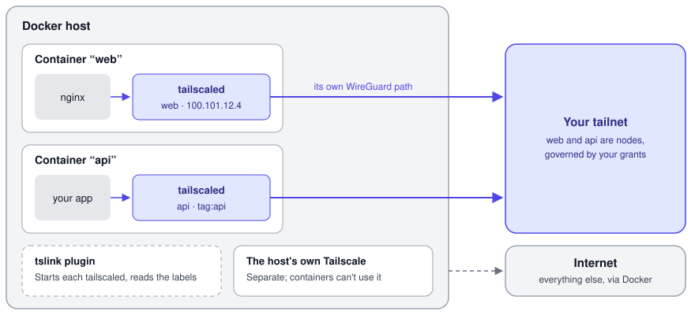

<h1 align="center">tslink</h1>

<p align="center">
  Put every Docker container on your tailnet as a node of its own.<br>
  A Docker network plugin for Tailscale, on a single host or across a Swarm.
</p>

<p align="center">
  <a href="https://github.com/matchory/tslink/releases/latest"></a>
  <a href="https://github.com/matchory/tslink/actions/workflows/ci.yml"></a>
  <a href="LICENSE"></a>
</p>

<p align="center">
  
</p>

## Why tslink?

Your tailnet policy is written in terms of nodes and tags. Containers don't fit that model out of the box: you can
run Tailscale on the host and publish ports, but then every container shares the host's identity, and a grant to the
host is a grant to all of them. You can add a `tailscale/tailscale` sidecar to each container, but that's one more
container, state volume and auth setup per service, and it doesn't work on Swarm at all: `docker stack deploy`
ignores the `network_mode: service:` the sidecar depends on. Or you can embed Tailscale in the application with
[tsnet](https://tailscale.com/docs/features/tsnet), if you own the code and it's written in Go.

tslink makes the container itself the node. Attach a container to a tslink network, and the plugin starts a
tailscaled in the container's network namespace: the container gets its own name, tailnet address and tags, and your
grants apply to it like to any other node. You configure it with labels, the way you configure everything else in
Docker. If you know Tailscale's [Kubernetes operator](https://tailscale.com/docs/kubernetes-operator), tslink is
the same idea for Docker and Swarm: the platform puts your workloads on the tailnet, and the workloads don't have to
know about it.

## Quick start

You need Docker on Linux (or in the Linux VM of OrbStack or Docker Desktop) and a Tailscale
[auth key](https://login.tailscale.com/admin/settings/keys). On an ARM host, replace `amd64` with `arm64`:

```bash
docker plugin install --alias tslink --grant-all-permissions ghcr.io/matchory/tslink:latest-amd64
docker network create --driver tslink:latest --opt tslink.authkey=tskey-auth-… my-tailnet
docker run -d --network my-tailnet --label tslink.hostname=web nginx:alpine
```

A few seconds later, `web` shows up in your admin console as a node of its own. [Getting
started](docs/getting-started.md) takes it further, to HTTPS with a certificate for `web.<tailnet>.ts.net`.

## What you get

- **A node for each container**, with its own hostname, tailnet address and tags, separate from the host. Tags set
  on the network take precedence over the container's labels, so a container can't pick its own.
- **A stable identity.** tslink keeps a node's state by hostname, so a container that's recreated with the same name
  comes back as the same node, with the same address.
- **HTTPS and Tailscale Services from labels.** `tslink.serve.443=https:80` serves a container over HTTPS with a
  certificate for its name. `tslink.service` makes it one backend of a
  [Tailscale Service](https://tailscale.com/docs/features/tailscale-services), and a container can back several.
- **Swarm support.** Each stack gets its own tags, from one cluster credential or an OAuth client per stack, and a
  stack can't use another stack's network, identity or state.
- **Updates without dropped requests.** Before a Service backend stops, tslink drains it and waits until Tailscale's
  control server knows, so callers move to the other backends first.
- **Isolation from the host.** By default, containers reach the tailnet only as their own node, never through the
  host's Tailscale, and they can't reach each other's tslink interfaces.
- **Self-healing.** tslink restarts a crashed tailscaled, logs a deleted node in again, picks up running containers
  after a plugin restart, and logs out the ephemeral nodes of containers that vanished.
- **A readiness endpoint** for Docker healthchecks, which reports ready once the node is up and its Services are
  advertised and approved.
- **A pinned Tailscale.** Each release bundles one Tailscale version and downloads nothing at runtime.

## How it compares

| | Node per container | Works on Swarm | App changes | Extra containers |
| --- | --- | --- | --- | --- |
| **tslink** | Yes | Yes | None | None |
| `tailscale/tailscale` sidecar | Yes | No: stacks ignore `network_mode` | None | One per container |
| Tailscale on the host, published ports | No: all share the host's node | Yes | None | None |
| tsnet in the application | Yes | Yes | Embed tsnet (Go) | None |

On Kubernetes, use Tailscale's [Kubernetes operator](https://tailscale.com/docs/kubernetes-operator) instead.

## What tslink doesn't do

- **It runs on Linux only.** On macOS and Windows, it runs in the Linux VM of OrbStack or Docker Desktop.
- **The application starts before its node.** Docker doesn't tell the plugin which container is starting, so tslink
  brings up the node once the container is running. Until then, connections to the tailnet fail at once, so an
  application that needs the tailnet at startup has to retry.
- **MagicDNS names need `dns: [100.100.100.100]`** on the container. Tailnet addresses work without it.
- **Upgrading the plugin pauses tailnet traffic** for a few seconds while each tailscaled restarts.
- **[headscale](https://github.com/juanfont/headscale) support is best-effort**, and Tailnet Lock is untested.

The [limitations](docs/explanation/limitations.md) page has the details, and the [security
model](docs/explanation/security-model.md) says what tslink protects against and whom you have to trust.

## Documentation

The documentation is at <https://matchory.github.io/tslink/>, and in [`docs/`](docs/README.md) in this repository:

- **Start here:** [getting started](docs/getting-started.md), a first container with HTTPS in a few minutes.
- **Guides:** [install and upgrade](docs/guides/install-and-upgrade.md),
  [provision a host](docs/guides/provision-a-node.md), [deploy on Swarm](docs/guides/deploy-on-swarm.md),
  [expose a service](docs/guides/expose-a-service.md), [update without downtime](docs/guides/zero-downtime-updates.md),
  [monitor](docs/guides/monitor.md) and [troubleshoot](docs/guides/troubleshoot.md).
- **Reference:** [network options](docs/reference/network-options.md),
  [container labels](docs/reference/container-labels.md), [plugin settings](docs/reference/plugin-settings.md),
  [credentials](docs/reference/credentials.md), [readiness endpoint](docs/reference/readiness-endpoint.md),
  [files and paths](docs/reference/files-and-paths.md) and [`tslink diag`](docs/reference/diag.md).
- **Explanation:** [architecture](docs/explanation/architecture.md),
  [security model](docs/explanation/security-model.md), [HTTPS certificates](docs/explanation/https-certificates.md)
  and [limitations](docs/explanation/limitations.md).

## Contributing

[CONTRIBUTING.md](CONTRIBUTING.md) covers building, testing and releasing tslink. Please report vulnerabilities as
[SECURITY.md](SECURITY.md) describes, not in public issues. What changed in each release is in
[CHANGELOG.md](CHANGELOG.md).

## License

MIT; see [LICENSE](LICENSE). The plugin image bundles Tailscale (BSD 3-Clause) and Go modules under their own
licenses, with their notices in `/usr/share/licenses` in the image.

tslink began as a fork of [aaomidi/tslink](https://github.com/aaomidi/tslink) by Amir Omidi.

tslink is an independent project, not affiliated with or endorsed by Tailscale Inc. Tailscale is a trademark of
Tailscale Inc.
