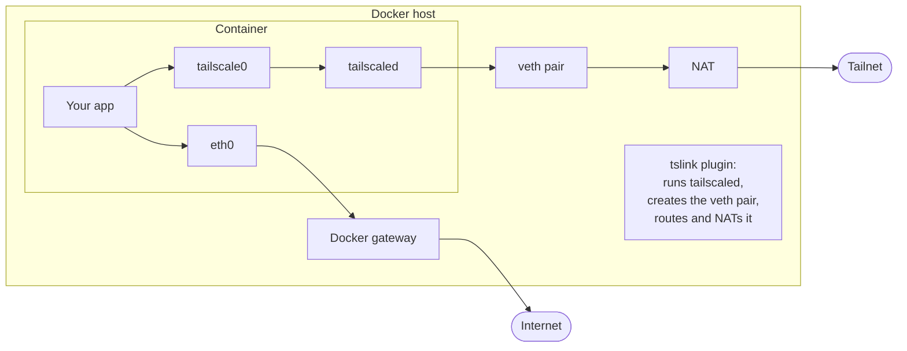

# Architecture

tslink is a Docker network plugin. For every container on a tslink network, it runs a tailscaled inside the
container's network namespace, so the container itself is a node in your tailnet, with its own identity and
addresses. This page explains how that works, and why it's built the way it is.

## The big picture

A container on a tslink network has two ways out:

- **To the tailnet**, through `tailscale0` to its own tailscaled. tailscaled sends its encrypted WireGuard traffic out
  through a veth pair that tslink adds to the container.
- **Everywhere else**, through `eth0` and Docker's usual gateway, which is `docker_gwbridge` on a Swarm.

## Starting a node

Docker expects a network plugin to answer quickly when it connects a container, but logging a node in can take more
than 60 seconds. So tslink splits the start in two:

1. When Docker connects the container, tslink creates the veth pair and answers right away.
2. tslink watches Docker's events. Once the container has started, it reads the container's name and labels, and
   starts tailscaled in the background.

Until tailscaled is up, the container has no node, and connections to tailnet addresses fail at once rather than
going anywhere else. [Start-up delay](limitations.md#start-up-delay) explains what that means for your application.

## Identity

tslink keeps a node's state by hostname, not by container ID. A container that starts with the hostname of an
earlier one gets the earlier identity: the same node and the same tailnet addresses. That's what lets you recreate a
container without a new device appearing in your tailnet.
[`tslink.hostname`](../reference/container-labels.md#tslinkhostname) lists the exceptions.

A Swarm stack's containers keep their state directories under the stack's own directory (see
[state directories](security-model.md#state-directories-are-in-the-directory-of-the-stack)), and only one endpoint at
a time can use a state directory.

## Routing

Docker gives the container its usual default gateway, and tslink leaves it alone: without it, Docker's embedded DNS
server doesn't resolve public names.

The veth pair carries tailscaled's own traffic and nothing else. tailscaled marks its sockets, and a routing rule
sends marked traffic to a table whose default route goes through the veth pair. In the container's main routing
table, the tailnet's address ranges are unreachable. So tailnet traffic either leaves through the container's own
tailscaled, or doesn't leave at all.

Each veth pair gets a /30 subnet from `10.200.0.0/16`, and the host masquerades it.

Every tailscaled listens on UDP port 41641. Plain masquerading would give a container a different external port per
destination whenever another flow from the host already used its port, and hole punching between hosts would fail.
So the host maps each container's port 41641 to an external port of its own, from the plugin setting
[`TSLINK_WIREGUARD_PORTS`](../reference/plugin-settings.md#tslink_wireguard_ports). A container then uses the same
external port towards every peer, and peers on other hosts can reach it directly.

Each tailscaled also advertises the host's private IPv4 addresses with that external port, so two containers on hosts
that share a private network connect over it directly instead of through a DERP relay. tslink reads the addresses
when tailscaled starts, and restarts tailscaled if they change.

The host drops new, unsolicited UDP packets to `TSLINK_WIREGUARD_PORTS`. Otherwise a peer's probe that arrives before
the container has sent the peer anything would leave a connection-tracking entry behind that blocks the container's
own traffic to that peer.

## Isolation

A container reaches the tailnet only as its own node, never as the host. Routes alone can't promise that: they stop
sockets, not raw frames, and a host's tailscaled accepts traffic forwarded to it. So the host enforces it with
firewall rules as well.

### Isolation from the host's node

Containers on the host can't reach the tailnet through the host's tailscaled, and can't reach the host's tailnet
addresses. This covers every container, on tslink networks and on any other network.

The rules match Docker's default interface names, and the bridges that have a name of their own
(`com.docker.network.bridge.name`). tslink asks Docker for these names when it starts, on every watchdog run, and
whenever a network is created. It keeps the last list in its data directory, and starts with that list plus the
bridges its rules already cover, so it never has to wait for Docker before it can accept requests: after a host
reboot, Docker answers no API call involving plugins until the plugin is serving.

tslink installs the rules before it accepts requests, restores them when something changes them, and keeps them when
the plugin stops. The plugin setting
[`TSLINK_ISOLATE_HOST_TAILNET`](../reference/plugin-settings.md#tslink_isolate_host_tailnet) turns them off. This is
guarantee `G1` in [SECURITY.md](../../SECURITY.md), which also lists the conditions it relies on.

### Isolation between containers

The host drops everything it forwards to `10.200.0.0/16`, whatever interface it arrives on, except two kinds of
traffic: replies on connections the container opened, and tailscaled's WireGuard traffic on UDP port 41641 from
tslink's veth pairs. So containers can't reach each other's veth addresses, and neither can a machine on the LAN that
routes `10.200.0.0/16` through the Docker host. Two nodes on the same host still connect directly, without a DERP
relay. This isolation is always on.

## DNS

tailscaled answers DNS queries in the container, and forwards names outside the tailnet to upstream servers. It takes
them from the first of these sources that has any:

1. The container's own DNS servers: `dns` of the container or service, or else `dns` in `/etc/docker/daemon.json`.
   tslink leaves out Tailscale's servers (`100.100.100.100`, `fd7a:115c:a1e0::53`) and Docker's (`127.0.0.11`). It
   keeps servers on the loopback interface, such as `127.0.0.1`, because they run in the network namespace tailscaled
   shares.
2. The DNS servers in the host's `/etc/resolv.conf`, except those on the host's loopback interface.
3. systemd-resolved's upstream servers, in `/run/systemd/resolve/resolv.conf`.

These are the same sources Docker uses. If none has a server, tailscaled uses Docker's DNS server, or, if the
container's DNS server is `100.100.100.100`, Google's public servers, which is Docker's own default. Either way,
tslink reports a `dns-upstreams` warning in the plugin log and the status file.

tailscaled picks its servers when it starts, as Docker does when the container starts. Docker doesn't include the
`dns` setting of `daemon.json` in the container's configuration, so tslink reads it from the comments Docker writes
into the container's `/etc/resolv.conf`. If the container has rewritten that file, tslink can't find the setting.

## Self-healing

tslink recovers from these failures on its own:

| Failure | What tslink does |
| --- | --- |
| tailscaled doesn't start | Tries again, at growing intervals, until the container leaves. A permanent error ends the retries: one of tslink's own refusals, such as a tag outside the stack's [tag rules](../reference/credentials.md#tag-rules) or an invalid Service name. |
| tailscaled stops | Restarts it. After a series of crashes, it waits for a while, then carries on. |
| The control server doesn't know the node, for example because someone deleted the device | Logs the node in again, as a new device. |
| The plugin restarts | Finds the running containers again. A node that's still logged in comes up without the credential, so a rotated or revoked credential doesn't take it down. |
| A container vanishes without tslink being told, for example in a power loss | Logs out the ephemeral nodes no container uses any more, and deletes their state, so a container with a fixed `tslink.hostname` gets its name back instead of `<hostname>-1`. |
| The control server doesn't pick up the Services a node advertises | Advertises them again, up to 3 times. See [advertising](#advertising). |

## Advertising

When a node advertises a Service, tailscaled tells the control server, which then fetches the node's Service list.
`tailscaled.log` shows each fetch as `c2n: GET /vip-services received`.

After a plugin restart, the control server sometimes didn't fetch the list. In the cluster test, this happened on 2
of 5 hosts, and their backends got no traffic for more than 13 minutes, until the advertised Services changed again.
That's the control server's behavior, and tslink works around it: if there's no fetch within 15 seconds of an
advertisement, tslink withdraws the advertisement and makes it again 2 seconds later. It does this up to 3 times,
with a warning in the plugin log each time.

## Draining

When a container is a backend of a Tailscale Service, tslink takes it out of rotation before it stops:

1. Docker sends the container its stop signal. tslink sees the event and drains the backend, and callers move to the
   other backends.
2. A container that stops without a stop signal, because it crashed or exited, is drained when it leaves the network.
3. tslink waits until the control server has fetched the drained Service list: at least 1 second, at most 10.
4. Only then does it log an ephemeral node out and delete its state, or stop tailscaled.

The wait matters: a node that stops before the control server knows about the drain keeps receiving traffic for
minutes. A drain is also final. tslink doesn't make the container a backend again, not even after tailscaled
restarts.

tslink learns from `tailscaled.log` when the control server has the drained list: tailscaled logs every change to the
advertised Services before it makes it, and every fetch before it reads the list. tslink waits for a fetch after its last
change, including a change whose request timed out but took effect. If tailscaled restarts while tslink waits, the new
tailscaled removes the Services first, and tslink waits for the control server to fetch that removal instead. If the
container leaves while its node is still starting, tslink lets the start finish, drains the node, then stops it.

If there's still no fetch after 10 seconds, tslink logs a warning and stops the node anyway. Callers can then reach a
stopped node until the control server removes it. In the cluster test, this happened once, and no request failed.

When Docker itself stops, it sends no more events. The
[drain drop-in](../guides/zero-downtime-updates.md#install-the-drain-drop-in) drains the host's backends before Docker
stops.

## Throughput

Measured on a 4-vCPU cloud VM with Ubuntu 24.04 and Docker 29.8:

| Condition | Tailnet throughput |
| --- | --- |
| The host itself | 2.8 Gbit/s |
| A container, without UDP GRO forwarding | 1.2 Gbit/s, 40 % of the host |
| No outbound UDP, through a DERP relay | 25 Mbit/s |

That's why [Provision a host](../guides/provision-a-node.md) turns on UDP GRO forwarding.

## Binaries

The plugin image contains the Tailscale binaries tslink runs, and tslink downloads nothing at runtime. Each tslink
release pins one Tailscale version, which Dependabot keeps up to date. tailscaled writes its output to
`tailscaled.log` in the node's state directory.
